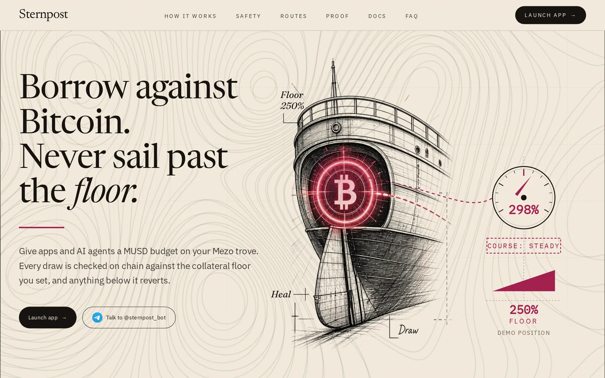
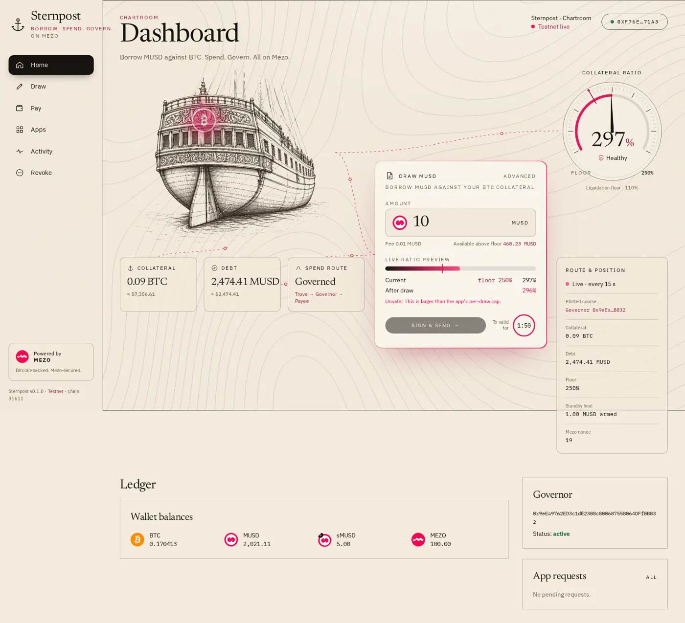
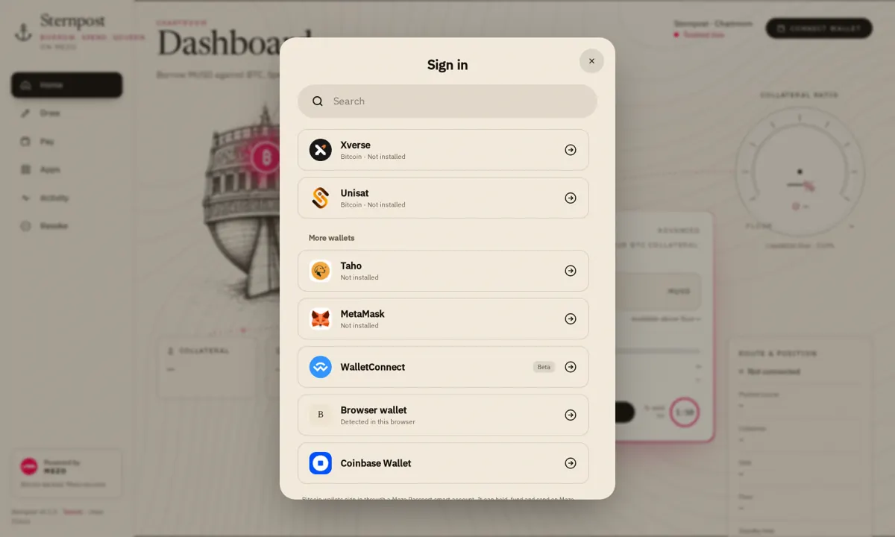
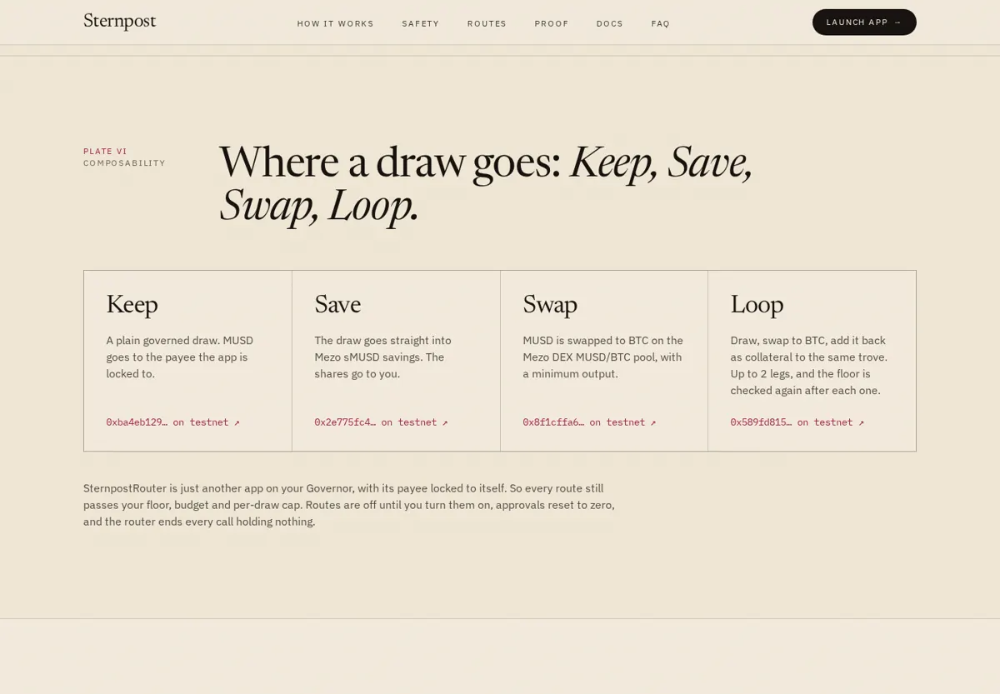
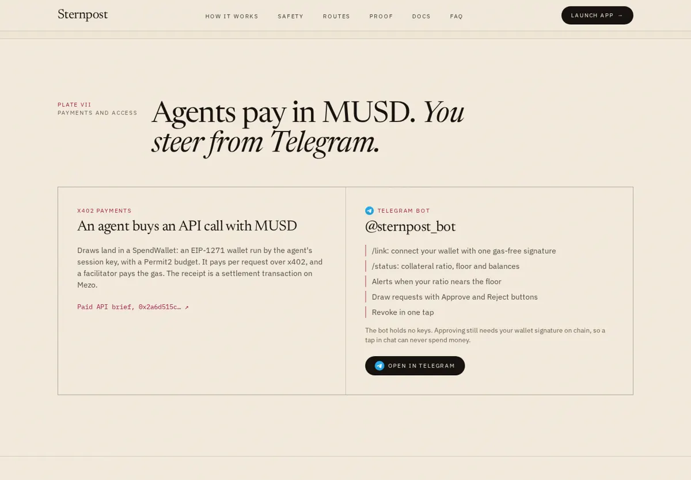
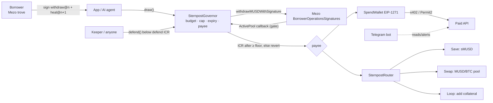
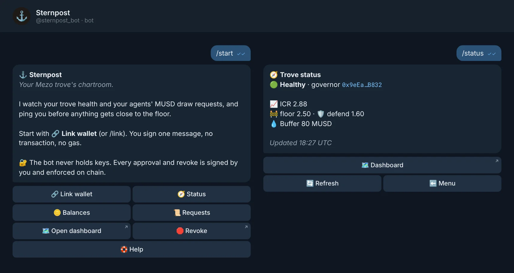

<div align="center">



# Sternpost

**Guarded MUSD credit lines for apps and AI agents, on your Mezo trove.**

[](https://github.com/mohamedwael201193/Sternpost/actions/workflows/contracts.yml)
[](https://github.com/mohamedwael201193/Sternpost/actions/workflows/sdk.yml)
[](https://github.com/mohamedwael201193/Sternpost/actions/workflows/backend.yml)
[](https://github.com/mohamedwael201193/Sternpost/actions/workflows/codeql.yml)
[](#tests)
[](LICENSE)

[**Live app**](https://sternpost-pink.vercel.app) · [**API**](https://sternpost-api.vercel.app) · [**Telegram bot**](https://t.me/sternpost_bot) · [For judges](judges/JUDGES.md) · [All testnet txs](judges/TESTNET_TXS.md) · [Threat model](docs/THREAT_MODEL.md)

</div>

## TL;DR

- **Problem:** a Mezo `WithdrawMUSD` signature is all-or-nothing. It has no budget, no payee, and nothing stops it pushing your trove toward liquidation.
- **Solution:** give an app or agent a *budget*, not your keys. The `SternpostGovernor` checks budget, cap, expiry and payee, then re-checks your collateral ratio **after** the withdraw and reverts below your floor ([`0xf3920683…`](https://explorer.test.mezo.org/tx/0xf3920683b0a0b6a3db2ab9227c747112ecda5aa501ca4c426c3408df7fa19bbf)).
- **The gate:** a signature sent straight to Mezo reverts ([`0xfd93314c…`](https://explorer.test.mezo.org/tx/0xfd93314cb952bf5542b76fd4fe69de500f88dd061e482170e11a4cc7f90a36e2)). **Revoke** kills every outstanding signature in one tx ([`0xf0763cf4…`](https://explorer.test.mezo.org/tx/0xf0763cf43766a93d921e3085f6eaa727c0fa6d09047130388a53297b3b0d72eb)).
- **Composable:** Keep / Save / Swap / Loop routes, x402 payments from an EIP-1271 SpendWallet, and a Telegram bot.
- **Proof:** live on Mezo testnet, fork-tested on Mezo testnet *and* mainnet, deployed bytecode matched byte-for-byte to this repo.

## Screenshots

| Dashboard | Wallet picker |
|---|---|
|  |  |
| **Routes (landing)** | **Telegram bot (landing)** |
|  |  |

## How it works

1. **Set a floor.** The borrower deploys a governor from the factory with a floor ICR (demo: 250%) and a defend ICR (demo: 160%).
2. **Authorize an app.** Budget, per-draw cap, expiry and an optional payee lock. `previewDraw()` returns a plain reason (`BELOW_FLOOR`, `OVER_BUDGET`, …) before anything is signed.
3. **Draw.** The borrower signs `withdraw@n` + `heal@n+1`; the app submits through `draw()`. The governor enforces policy and the post-draw floor, or the whole tx reverts.



## Mezo integration

| Mezo component | How Sternpost uses it |
|---|---|
| `BorrowerOperationsSignatures` | Draws via `withdrawMUSDWithSignature`; heals/loops via signed repay and AddColl |
| `ActivePool` callback | The gate: the governor accepts the BTC callback only inside its own `draw()` |
| `TroveManager` + `PriceFeed` | Post-draw ICR check against the floor |
| `MUSD` / `sMUSD` | Credit asset; the defend reserve and the Save route earn in sMUSD |
| Mezo DEX MUSD/BTC pool | Swap and Loop routes, with a min-out |
| Mezo Passport (OrangeKit) | Bitcoin-wallet sign-in in the app |

## SDK

```ts
import { Sternpost, pay, musdRequirements } from "@sternpost/sdk";

const sp = new Sternpost(publicClient);
const p = await sp.previewDraw(governor, app, parseEther("10"), spendWallet); // { ok, reason, text, icrAfter }
const auth = await sp.authorizeDraw(borrowerWallet, governor, parseEther("10")); // withdraw@n + heal@n+1
await sp.requestDraw(appWallet, governor, spendWallet, auth);                   // refuses a stale nonce locally
await pay({ wallet: spendWallet, agent, publicClient, requirements: musdRequirements(merchant, 10n ** 17n), resource });
await sp.revoke(borrowerWallet, governor);                                       // freeze + nonce burn
await sp.rearm(borrowerWallet, governor, parseEther("5"));
```

The full live run is [`sdk/examples/e2e-testnet.ts`](sdk/examples/e2e-testnet.ts) (`npm run e2e`).

## Deployments (Mezo testnet, chain 31611)

| Sternpost contract | Address |
|---|---|
| SternpostFactory | [`0x0632…6980`](https://explorer.test.mezo.org/address/0x0632A9FeA303c0dB4544BF642a8aD0467C6c6980) |
| SternpostGovernor (demo) | [`0x9eEa…B832`](https://explorer.test.mezo.org/address/0x9eEa9762ED3c1dE2308c800687558064DFf0B832) |
| SpendWallet (demo) | [`0x6330…41FA`](https://explorer.test.mezo.org/address/0x6330d69EbcA4ea00969a3f8085FE8BD5FC6D41FA) |
| SternpostRouter v2 | [`0xEC30…9674`](https://explorer.test.mezo.org/address/0xEC30280134f06668f35753D640c6760984179674) |
| SternpostRouter v1 (superseded) | [`0x7550…284c`](https://explorer.test.mezo.org/address/0x7550a53Cc5510B192A3B486368B8330D1CC7284c) |

| Mezo contract used | Address |
|---|---|
| BorrowerOperationsSignatures | [`0xD757…639e`](https://explorer.test.mezo.org/address/0xD757e3646AF370b15f32EB557F0F8380Df7D639e) |
| TroveManager | [`0xE47c…6bb0`](https://explorer.test.mezo.org/address/0xE47c80e8c23f6B4A1aE41c34837a0599D5D16bb0) |
| PriceFeed | [`0x86bC…9366`](https://explorer.test.mezo.org/address/0x86bCF0841622a5dAC14A313a15f96A95421b9366) |
| MUSD | [`0x1189…c503`](https://explorer.test.mezo.org/address/0x118917a40FAF1CD7a13dB0Ef56C86De7973Ac503) |
| sMUSD | [`0x6f46…8e16`](https://explorer.test.mezo.org/address/0x6f461c68B2c5492C0F5CCEc5a264d692aA7A8e16) |
| DEX router | [`0x9a1f…D7E9`](https://explorer.test.mezo.org/address/0x9a1ff7FE3a0F69959A3fBa1F1e5ee18e1A9CD7E9) |
| MUSD/BTC pool | [`0xd16A…6AA9`](https://explorer.test.mezo.org/address/0xd16A5Df82120ED8D626a1a15232bFcE2366d6AA9) |

ABIs: [`shared/abis`](shared/abis). Every address and hash: [`shared/deployments/testnet.json`](shared/deployments/testnet.json).

## Live proof

| What it proves | Tx |
|---|---|
| Factory deployed | [`0xfc32c758…`](https://explorer.test.mezo.org/tx/0xfc32c7584b4c14b12f2d171d787b5bc6a5098d79535bd3c967923ef37c53c50c) |
| Safe draw by an app key → SpendWallet | [`0xba4eb129…`](https://explorer.test.mezo.org/tx/0xba4eb1299298aa6ad661cb6ed83accc9ed07ff2a42ec1b4576bb3c5f67c71523) |
| Unsafe draw refused (`Unsafe`, ICR 218% < floor 250%) | [`0xf3920683…`](https://explorer.test.mezo.org/tx/0xf3920683b0a0b6a3db2ab9227c747112ecda5aa501ca4c426c3408df7fa19bbf) |
| Direct Mezo submission blocked by the gate | [`0xfd93314c…`](https://explorer.test.mezo.org/tx/0xfd93314cb952bf5542b76fd4fe69de500f88dd061e482170e11a4cc7f90a36e2) |
| Revoke + nonce burn | [`0xf0763cf4…`](https://explorer.test.mezo.org/tx/0xf0763cf43766a93d921e3085f6eaa727c0fa6d09047130388a53297b3b0d72eb) |
| Pre-revoke signature is dead (`BadHeal`) | [`0x1938e472…`](https://explorer.test.mezo.org/tx/0x1938e4723094d02f1b36b9e100885b7e4833f462d34b8dd75e023a0827b0be6f) |
| Reserve parked in sMUSD | [`0x00a348fc…`](https://explorer.test.mezo.org/tx/0x00a348fc43ea08e94451d4c340ef5af1d3f74ed98738b1bd27fb39f243ffb3e6) |
| x402 settle from the SpendWallet | [`0x4833c4a8…`](https://explorer.test.mezo.org/tx/0x4833c4a878d7efc6a7d7c47baca8a6901b12dfa7e3ca63d9985a5b565f114140) |
| x402 purchase of the paid API brief (live API) | [`0x2a6d515c…`](https://explorer.test.mezo.org/tx/0x2a6d515c2f325a917e33a77c7f611ca86ffbd7fb21489d0225f296e4ecf38d06) |
| Save route: draw → sMUSD | [`0x2e775fc4…`](https://explorer.test.mezo.org/tx/0x2e775fc4c97ee6762ad3bbb7b8634f02b888221ef6008f4f0a111f88ac53f311) |
| Swap route: draw → BTC with min-out | [`0x8f1cffa6…`](https://explorer.test.mezo.org/tx/0x8f1cffa6e45f14b612b5998a1e08ca1666a980fdc877401b6cb9ed5691cb1c91) |
| Loop route: 2 legs, floor re-checked each leg | [`0x589fd815…`](https://explorer.test.mezo.org/tx/0x589fd81568ee61521091b3be036c00c7852a6f030d0d052f32a5794d5d6735c1) |

The full 16-step flow and the router runs are in [`judges/TESTNET_TXS.md`](judges/TESTNET_TXS.md).

## Tests

Contracts, SDK and backend counts are from the latest green CI runs; fork and app counts from the last local runs. 203 in total (E2E not counted).

| Suite | Command | Result |
|---|---|---|
| Contracts: unit, branch, fuzz, invariant, reentrancy | `cd contracts && forge test` | **85 passing** (Governor 21 + 15 branch + 3 fuzz, Router 25 + 3 fuzz, SpendWallet 10, Factory 5, Reentrancy 1, invariants 2) |
| Fork, real Mezo **testnet** | `cd contracts && ./script/fork.sh testnet` | **10/10** (Governor 7 + Router 3) ([log](judges/logs/fork_testnet.txt)) |
| Fork, real Mezo **mainnet** | `cd contracts && ./script/fork.sh mainnet` | **7/7** (Router fork skipped: no router on mainnet) ([log](judges/logs/fork_mainnet.txt)) |
| SDK (EIP-712 digests equal Solidity) | `cd sdk && npm ci && npm test` | **9/9** |
| Backend (x402 API, indexer) | `cd backend && npm ci && npm test` | **72/72** (API, indexer, x402, Telegram bot) |
| App unit | `cd app && npx vitest run` | **20/20** |
| App E2E (Playwright) | `cd app && npx playwright test` | 6 passing; 3 live-draw specs need `MEZO_TESTNET_PK` |
| Coverage (contracts) | `forge coverage` | Factory and SpendWallet 100%; Governor 100% lines, 93.6% branches ([report](judges/coverage.txt)) |

## CI and security

- **CI:** [contracts](https://github.com/mohamedwael201193/Sternpost/actions/workflows/contracts.yml) (forge test + **Slither `--fail-high`**), [sdk](https://github.com/mohamedwael201193/Sternpost/actions/workflows/sdk.yml), [backend](https://github.com/mohamedwael201193/Sternpost/actions/workflows/backend.yml).
- **CodeQL:** [codeql.yml](https://github.com/mohamedwael201193/Sternpost/actions/workflows/codeql.yml).
- **Dependabot:** weekly for `sdk`, `backend` and GitHub Actions ([config](.github/dependabot.yml)).
- **Slither:** no high findings after triage ([triage](judges/SLITHER_TRIAGE.md), [raw](judges/slither.txt)).
- **Bytecode:** 3/3 deployed contracts match this source byte-for-byte, immutables masked ([how](judges/VERIFY.md)).

### Security model

- The borrower's key never leaves the borrower. Apps hold only an app key that can call `draw()` within policy.
- **Floor:** ICR after every draw ≥ floor, or revert. **Gate:** direct submission to Mezo reverts atomically. **Revoke:** freezes draws and burns the Mezo nonce. **Heal:** `defend()` repays from a reserve below the defend ICR, callable by anyone.
- Router routes are governor apps with the payee locked to the router, so they pass the same checks. Approvals reset to zero and a residue check ends every route.

### Residual risks

- The gate relies on Mezo's current ActivePool callback. If it is removed, draws **fail closed** (`CallbackMismatch`); a fork test covers this.
- Mezo has one signature nonce per borrower, so other signed actions disarm the defend standby until `rearm()`. A loop leg uses the heal nonce, so re-arm after a loop.
- Swap/Loop are proven live but not on forks (forks lack Mezo's BTC precompile). Loops are capped at 2 legs.
- Bitcoin wallets (OrangeKit) cannot draw: Mezo checks signatures with `ECDSA.recover` only.
- **Unaudited, testnet only.** Full analysis: [threat model](docs/THREAT_MODEL.md).

## For judges

1. Read [`judges/JUDGES.md`](judges/JUDGES.md).
2. `cd contracts && forge test`, then `./script/fork.sh testnet` and `./script/fork.sh mainnet`.
3. `forge build && python3 script/bytecode-match.py` → 3/3 MATCH.
4. `./judges/verify-routes.sh` to re-check the router txs on-chain.
5. Open any hash in [Live proof](#live-proof) on the explorer.

## Fit for the tracks

- **Track 1: DeFi (Borrowing, Lending, Looping, and Yield).** Governed MUSD borrowing against a Mezo trove with an on-chain floor, Save into sMUSD, Swap on the Mezo DEX, and Loop back into collateral (see [Live proof](#live-proof)).
- **Track 2: Access and Distribution for MUSD/MEZO.** The [Telegram bot](https://t.me/sternpost_bot) for monitoring and approvals, x402 MUSD payments for agents from an EIP-1271 SpendWallet, and Mezo-style multi-wallet access (Xverse, Unisat, MetaMask, WalletConnect and more).

## Telegram

[@sternpost_bot](https://t.me/sternpost_bot) is the chat front door to Sternpost. It is linked from the landing page and its footer.



<sub>Rendered from the bot's reply templates in <code>backend/src/telegram/ui.ts</code> with the demo trove's live testnet values.</sub>

- **Link:** `/link` asks for one wallet signature (no gas); the API checks it and binds the chat to your borrower address.
- **Watch:** `/status` reads ICR, floor, defend line and buffer from your Governor; `/balances` shows MUSD and MEZO.
- **Approve:** when an app posts a draw request through the API, the bot pushes a card with Approve, View, Verify and Deny. Approving opens the app to sign `authorizeApp`; status changes need your EIP-191 signature.
- **Alert and revoke:** a cron sweep pings you before ICR nears the floor, with a one-tap link to Revoke. The bot never holds keys.

## Roadmap

| Date | Milestone | Status |
|---|---|---|
| Oct 26, 2026 | Wave 1: governor, gate, revoke, routes, x402 on Mezo testnet | Live now |
| Nov 15, 2026 | Wave 2: deeper routes and agent tooling | Planned |
| Mar 31, 2027 | External audit, then mainnet | Planned |

## Wallets

The Sign in sheet follows testnet.mezo.org: Xverse and Unisat first, then MetaMask, Taho, WalletConnect and any wallet the browser announces (EIP-6963), plus Coinbase Wallet. Bitcoin wallets sign in through Mezo Passport's OrangeKit connectors and get a Mezo smart account that can hold, fund and send. They cannot draw: Mezo's `BorrowerOperationsSignatures` checks the EIP-712 signature with `ECDSA.recover` only (no EIP-1271), and OrangeKit has no `signTypedData`. The Draw screens say so and keep Sign & send disabled for those accounts.

Once connected, the wallet pill opens an account menu: copy address, view on the Mezo explorer, and disconnect (asks to confirm).

## Dashboard

- **Draw** starts from a safe amount, the "Max safe" chip. It is the lowest of three limits: your floor (trove health after the draw plus Mezo's fee), the app's per-draw cap, and its remaining budget. The chip says which one binds.
- **Apps** lists every authorized app (Router v1/v2, spend wallet, your own self-draw policy) with budget, remaining, per-draw cap, expiry and a per-app revoke. API draw requests are a separate list.
- **Activity** shows one row per transaction, with an explorer link.
- Below 1024px the sidebar becomes a bottom nav, and no page scrolls sideways at 390px.
- `/pay`, `/apps`, `/activity`, `/revoke` and `/draw` redirect to `/app/*`. Other paths get a 404.

## Repo

| Path | What |
|---|---|
| `contracts/` | Foundry: Governor, Factory, SpendWallet, Router, tests, fork scripts |
| `sdk/` | TypeScript (viem) SDK and the e2e example |
| `backend/` | x402 paid API and indexer (Vercel + Postgres) |
| `app/` | Chartroom landing and dashboard (Vercel) |
| `judges/` | Reproduction guide, tx tables, logs, reports |

## License

[MIT](LICENSE)
